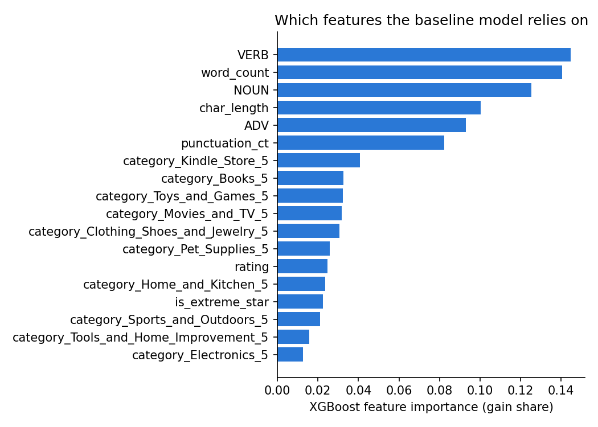

# Amazon ReviewGuard

ReviewGuard detects **computer-generated Amazon product reviews**. Given a review's text,
star rating and product category, an XGBoost classifier predicts whether the review was
written by a person (**OR**, original) or generated by a program (**CG**,
computer-generated).

**Result:** on 7,278 held-out reviews, the tuned model reaches **76.2% accuracy and 0.846
ROC-AUC**, using only 18 hand-engineered style features (no word content). The dataset is
balanced, so guessing would score about 50%.

## Dataset

`fake-reviews.csv` has **36,389 reviews** across 10 product categories, with columns
`category`, `rating`, `label` (`CG` or `OR`) and `text_`.

| Label | Reviews |
|---|---|
| CG (computer-generated) | 18,227 |
| OR (original, human-written) | 18,162 |

The categories are Books, Clothing/Shoes/Jewelry, Electronics, Home & Kitchen, Kindle Store,
Movies & TV, Pet Supplies, Sports & Outdoors, Tools & Home Improvement, and Toys & Games.

> **Source:** add the citation for where this dataset came from here.

## How it works

1. **Clean the text** ([`src/preprocess.py`](src/preprocess.py)): lowercase it, remove HTML
   tags (some reviews contain embedded product links and video blocks), remove URLs, and
   trim whitespace.
2. **Extract 18 features** ([`src/feature_extraction.py`](src/feature_extraction.py)):

   | Group | Features |
   |---|---|
   | Length and style | `char_length`, `word_count`, `punctuation_ct` |
   | Rating | `rating`, `is_extreme_star` (1 or 5 stars) |
   | Part of speech ([spaCy](https://spacy.io) `en_core_web_sm`) | counts of `VERB`, `NOUN`, `ADV` |
   | Product category | 10 one-hot columns |

3. **Train** ([`train_model.py`](train_model.py)): XGBoost, with an 80/20 train/test split
   (`random_state=42`, 29,111 training / 7,278 test reviews).
4. **Tune** ([`tune_model.py`](tune_model.py)): a grid search over **768 hyperparameter
   combinations** with **5-fold cross-validation** (3,840 fits), scored by ROC-AUC on the
   training set only. The test set is used once at the end to score the chosen model.

## Results

All numbers are on the same 7,278 held-out test reviews. Reproduce them with the scripts
below; they're saved in [`model/model_metadata.json`](model/model_metadata.json) and
[`model/tuning_results.json`](model/tuning_results.json).

| Model | Accuracy | ROC-AUC | Precision (CG / OR) | Recall (CG / OR) |
|---|---|---|---|---|
| Baseline: 100 trees, depth 4 | 75.5% | 0.838 | 0.756 / 0.754 | 0.767 / 0.742 |
| **Tuned:** 500 trees, depth 3, learning rate 0.3, L1 0.5, L2 1.0 | **76.2%** | **0.846** | 0.762 / 0.762 | 0.775 / 0.749 |

- **The grid search** took 20.3 minutes on an Apple M1 laptop. Its best cross-validated
  ROC-AUC was 0.856.
- **Confusion matrix of the tuned model** (rows are the true label):

  | | Predicted CG | Predicted OR |
  |---|---|---|
  | **True CG** | 2,873 | 836 |
  | **True OR** | 897 | 2,672 |

- **Feature selection:** keeping only the 16 features with importance of 0.02 or more gives
  76.2% accuracy and 0.847 ROC-AUC, so the two weakest category flags add nothing.

**What the model relies on.** Part-of-speech counts and length dominate: verbs, word count
and nouns are the top three features. Rating and most category flags matter much less.



## Limitations and next steps

- **Style only.** The model never sees *which words* a review uses, only counts and lengths,
  which is the main reason accuracy levels off around 76%. The natural next step is to add
  text features such as TF-IDF word and character n-grams, or sentence embeddings, and
  measure the gain against this baseline.
- **One dataset.** Results are for this dataset's generator and categories. Reviews from a
  different text generator may look different.
- **One split.** The numbers come from a single 80/20 split. Cross-validation is used for
  tuning, not for the final score.

## Run it

Requires Python 3.9 or newer.

```bash
python3 -m venv .venv && source .venv/bin/activate
pip install -r requirements.txt
python -m spacy download en_core_web_sm

python build_dataset.py      # clean text + extract features -> processed-dataset.csv (about 7 min, spaCy)
python train_model.py        # baseline model -> model/review_classifier.pkl + metrics
python tune_model.py         # full grid search (about 20 min); use --quick for a fast check
python predict.py "Great product, works as described!" --rating 5 --category Electronics_5
python -m pytest -q          # unit tests
python eda_starter.py        # optional: review length by label
```

`processed-dataset.csv` is committed, so you can skip `build_dataset.py`. Rebuilding it
produces an identical file.

## Project structure

```
src/preprocess.py           text cleaning
src/feature_extraction.py   the 18 features
build_dataset.py            fake-reviews.csv -> processed-dataset.csv
train_model.py              baseline model, metrics
tune_model.py               grid search, feature importance, feature selection
predict.py                  score one review with the saved model
eda_starter.py              quick exploratory plot
tests/                      pytest unit tests
model/                      saved models, metrics, feature importance
```

## Tech stack

Python · pandas · scikit-learn · XGBoost · spaCy · Joblib · Matplotlib · pytest
